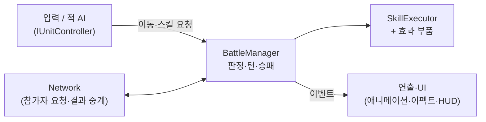

# Dungeon4Player

> 1~4인이 함께 던전을 내려가는 **3D 쿼터뷰 협동 턴제 로그라이크** (Unity 6)

<!-- ▶ **플레이 영상:** [영상 링크](VIDEO_URL) -->

<!--  -->


---

## 1. 프로젝트 소개

직업이 다른 캐릭터들로 파티를 꾸려, 갈림길 맵에서 방을 골라 가며 전투를 이어 갑니다. 마지막 15층에서 보스 골렘을 쓰러뜨리면 클리어입니다. 혼자서도, 온라인으로 최대 4명이 함께 할 수도 있습니다.

이 프로젝트는 **AI 에이전트와 역할을 나눠 게임 하나를 기획부터 멀티플레이까지 만들어 보는 것**을 목표로 했습니다. 저는 방향과 규칙을 정하고 결과를 검수했으며, 기획서 초안·코드 구현·테스트·문서화는 AI(Claude Code)가 맡았습니다. 자세한 방식은 [6. AI 활용 방식](#6-ai-활용-방식)에 정리했습니다.

또한 이전에 AI를 제한적으로만 쓰며 직접 만든 프로젝트 **Dungeon Explorer**와 기획을 거의 같게 잡아, **AI를 전적으로 활용했을 때와 제한적으로 활용했을 때**를 비교했습니다. 결과는 [7. 이전 프로젝트와 비교](#7-이전-프로젝트와-비교)에 있습니다.

| 항목 | 내용 |
|---|---|
| 장르 | 로그라이크 RPG, 턴제 전투 |
| 시점 | 3D 쿼터뷰 (줌인하면 3인칭에 가깝게) |
| 인원 | 1~4인 (싱글 / 온라인 협동) |
| 개발 기간 | 2026.11.17 ~ (약 1주 만에 현재 상태, 진행 중) |
| 규모 | C# 스크립트 115개(약 1.9만 줄), 자동 테스트 405개, GitHub 이슈 48개 |

## 2. 개발 환경

| 항목 | 내용 |
|---|---|
| 엔진 | Unity 6 (6000.6), URP |
| 언어 | C# |
| 멀티플레이 | Netcode for GameObjects + Unity Multiplayer Services (Relay·Lobby) |
| 테스트 | Unity Test Framework (EditMode) |
| 버전·일정 관리 | Git, GitHub 이슈 |
| AI 도구 | Claude Code, Unity MCP(에디터 조작), Blender MCP(간단한 3D 모델 제작) |

## 3. 주요 기능

- **턴제 전투:** 속도에 비례해 차는 액션 게이지로 턴 순서가 정해지고, 빠른 캐릭터는 더 자주 행동합니다. 이동력·행동 토큰·마나 세 가지 자원을 씁니다.
- **그리드 없는 자유 이동:** 실제 경로 길이만큼 이동력을 쓰고, 다른 유닛은 길을 막습니다.
- **지형 전술:** 복층 맵의 높이 차, 시야, 밀치기와 낙사, 남아서 영향을 주는 장판(화염·지진 등)이 있습니다.
- **직업 4종과 스킬:** 전사·궁수·마법사·클레릭. 시작 스킬로 출발하고 전투 보상으로 새 스킬을 얻습니다.
- **적 AI:** 근접·원거리·마법사 역할별 행동, 장판 피하기, 사거리와 층을 고려한 접근.
- **보스 골렘:** 지진으로 둔화를 건 뒤 예고한 방향으로 돌진하는 보스. 예고 표시, 넘어짐, 기둥 충돌 기절, 체력 50% 분노 단계가 있습니다.
- **던전 진행:** 15층 갈림길 맵, 전투 맵 5종(던전·지하 묘지·숲속 공터·협곡 다리·보스 투기장), 휴식 방, 보상 선택, 진행 세이브와 이어하기.
- **온라인 협동:** 방 코드로 접속(포트포워딩 없음), 플레이어별 캐릭터 소유, 인원수에 따른 난이도 조정, 연결 끊김 처리.

## 4. 스크립트 구조

### 전체 흐름



- 플레이어 입력과 적 AI는 같은 인터페이스(`IUnitController`)로 `BattleManager`에 행동을 **요청**만 합니다.
- 판정은 `BattleManager`가 하고, 연출·UI는 `BattleManager`의 이벤트(`TurnStarted`, `SkillUsed` 등)를 구독해 보여 주기만 합니다.
- 멀티에서 참가자 PC의 `BattleManager`는 판정하지 않고, 방장이 보낸 결과로 같은 이벤트를 일으킵니다. 그래서 연출·UI 코드는 싱글과 멀티를 구분하지 않습니다.

### 데이터 (ScriptableObject)

밸런스와 콘텐츠는 코드가 아니라 데이터 에셋으로 조정합니다.

| 에셋 | 내용 |
|---|---|
| `SkillDefinition` | 스킬 하나: 비용, 대상, 전달 방식, 효과 부품 목록 (34개) |
| `UnitDefinition` | 유닛 하나: 능력치, 이동력·토큰·마나, 스킬, 동작 타이밍, AI 성향, 몸 크기, 분노 단계 |
| `ClassCatalog` | 직업 목록: 직업별 유닛·프리팹, 시작 스킬, 보상으로 얻는 스킬 |
| `MapRules` | 갈림길 맵 생성 규칙 (층 수, 층별 방 수, 연결, 휴식 방 배치) |
| `EncounterRules` | 층별 적 수·종류, 층과 파티 인원에 따른 체력·공격력 배율 |
| `BattlePreset` | 전투 맵 구성: 어느 씬에서 싸우는지, 적이 설 자리 |
| `RewardDefinition` / `RewardCatalog` | 전투 보상과 보상 목록 |
| `SkillCatalog` | 네트워크 메시지에서 스킬을 번호로 가리키기 위한 목록 |

목록형 에셋(직업·보상·스킬 목록, 적 종류 표)은 **순서 = 번호**로 쓰여, 세이브와 네트워크 메시지가 에셋 대신 번호를 주고받습니다. 그래서 새 항목은 항상 끝에 추가합니다.

### 스킬 스크립트

스킬은 스크립트를 새로 만들지 않고, `SkillDefinition` 에셋에 **효과 부품을 순서대로 끼워** 만듭니다.

```
SkillDefinition (ScriptableObject)
├─ 기본       이름, 설명, 행동 토큰·마나 비용
├─ 대상       적 / 아군 / 자신 / 바닥 지점 / 직선 / 자기 주변, 사거리, 범위
├─ 전달 방식   동작, 투사체, 예고 여부, 타이밍
└─ 효과 목록   [SerializeReference] List<SkillEffect>  ← 위에서부터 순서대로 적용
```

- 효과 부품은 추상 클래스 `SkillEffect`를 상속하고 `Apply(SkillContext)`를 구현합니다. 피해·회복·보호막·상태 효과·밀치기·돌진·장판·오라·연쇄·반복 등 13종이 있습니다.
- `[SerializeReference]`와 전용 인스펙터(`SkillEffectListDrawer`)로, 인스펙터에서 부품 종류를 골라 목록에 넣고 수치를 바로 고칠 수 있습니다.
- 예를 들어 보스 골렘의 돌진(`Skill_GolemCharge`)은 `직선 대상 + [돌진 → 피해 → 상태 효과(넘어짐) → 밀치기]`입니다. 독특한 스킬이 필요하면 새 부품 클래스만 추가하고, `BattleManager`·`SkillExecutor`는 고치지 않습니다.
- 플레이어와 적이 같은 스킬 에셋을 쓰고, 적 AI는 스킬의 대상·범위 정보를 읽어 어디에 쓸지 고릅니다.

### 폴더

```
Assets/_Project/
├── Scripts/
│   ├── Combat/        # 전투 판정 (BattleManager, 스킬 실행, 이동 규칙, 상태 효과)
│   │   ├── Effects/   # 스킬 효과 부품 (피해·밀치기·장판·돌진 등)
│   │   └── AI/        # 적 AI (행동 고르기, 위치 잡기, 장판 피하기, 보스 순서)
│   ├── Network/       # 멀티플레이 (요청·결과 메시지, 동기화, 접속)
│   ├── Run/           # 한 판 진행 (갈림길 맵, 보상, 세이브)
│   ├── Presentation/  # 애니메이션·이펙트 (전투 이벤트를 듣고 연출)
│   ├── UI/            # 전투 화면·메뉴
│   ├── Cameras/       # 쿼터뷰 카메라
│   └── DebugTools/    # 개발용 디버그 패널
├── Data/              # 스킬·유닛·직업·전투 구성 데이터 (ScriptableObject)
├── Scenes/            # 메인 메뉴, 접속, 맵, 전투 맵 5종
└── Tests/EditMode/    # 자동 테스트
Docs/                  # 기획서, 구조 문서, 네트워크 설계, 로드맵
```

## 5. 기술 포인트

### 판정은 한 곳에서, 연출은 이벤트로
전투의 모든 판정은 `BattleManager` 한 곳에서 합니다. 플레이어 입력과 적 AI는 행동을 *요청*만 하고, 애니메이션·이펙트·UI는 `BattleManager`가 내는 이벤트를 듣고 보여 주기만 합니다. 이 구조 덕분에 같은 코드가 싱글과 멀티에서 그대로 동작합니다.

### 방장 판정 멀티플레이
방장 PC가 서버 역할을 합니다. 참가자는 "이 스킬을 여기에 쓰겠다" 같은 요청을 보내고, 방장이 판정한 결과와 상태 값을 받아 화면에 반영합니다. 랜덤(낙석 위치 등)도 방장만 정해 PC마다 결과가 어긋나지 않게 했습니다. 싱글도 "아무도 들어오지 않는 방"으로 돌려 맵·보상·세이브 코드를 하나로 유지했습니다.

### 부품을 조합하는 스킬
스킬은 `대상 + 전달 방식 + 효과 부품 목록`으로 만들어, 새 스킬 대부분은 코드 없이 데이터만으로 추가합니다([4. 스크립트 구조](#4-스크립트-구조)). 범위 미리보기도 판정과 같은 함수를 불러 화면에 보이는 범위와 실제 판정이 항상 같습니다.

### 실행 중 길찾기 갱신
장판이 깔리거나 사라질 때 길찾기 바닥(NavMesh)을 실행 중에 다시 굽고, 유닛은 서 있는 자리에 구멍을 뚫어 다른 유닛이 지나가지 못하게 했습니다. 몸집이 큰 유닛(트롤·골렘)은 구멍과 겹침 판정이 몸 크기만큼 커집니다.

### 자동 테스트
전투 규칙(피해 계산, 사거리, 밀치기, 장판, AI 선택, 세이브 등)을 EditMode 테스트 405개로 검증합니다. AI가 코드를 고칠 때마다 전체 테스트를 돌려 기존 규칙이 깨지지 않았는지 확인합니다.

## 6. AI 활용 방식

### 역할 나누기

| 사람 (나) | AI (Claude Code) |
|---|---|
| 게임 방향·규칙·수치 결정 | 기획서 초안 작성, 빠진 규칙·예외 지적 |
| 설계 확정 (컨펌) | 작업을 이슈 단위로 나누고 순서 제안 |
| 플레이로 결과 검수, 수정 요청 | 코드 구현, 테스트 작성, 플레이 테스트 |
| AI 제안을 받아들일지 결정 | 기획서·구조 문서·로드맵 갱신, 커밋 |

### 작업 흐름


- **지침 파일:** 모든 프로젝트에 쓰는 규칙은 전역 `CLAUDE.md`에, 이 프로젝트 규칙(언어, 커밋 방식, 구현 전 설명과 컨펌, 에디터 사용 규칙 등)은 프로젝트 `CLAUDE.md`에 둡니다.
- **문서 4종:** 기획서(약 1,500줄), 구조 문서, 네트워크 설계 문서, 로드맵을 AI가 작업과 함께 갱신합니다. 기획이 바뀌면 기획서를 먼저 고치고, 예전 방식도 변경 이력에 남깁니다.
- **메인 세션과 작업 세션:** 메인 세션은 이슈 순서를 정하고 결과(커밋·테스트·이슈 상태)를 검수해 보고합니다. 구현은 이슈마다 새 작업 세션이 맡아 메인 세션의 대화가 지나치게 길어지지 않게 합니다.
- **병렬 작업:** 전투 시스템을 처음 만들 때는 이동·피해 계산·화면 표시처럼 서로 독립된 스크립트를 여러 에이전트가 동시에 작성하고, 합치고 Unity에서 확인하는 일은 메인 세션 하나가 맡았습니다. Unity 에디터는 하나라서 에디터를 쓰는 세션은 한 번에 하나만 돌립니다.
- **MCP 연결:** Unity와 Blender를 MCP 서버로 연결해 AI가 씬 배치, 플레이 테스트, 스크린샷 확인, 간단한 3D 모델 제작까지 직접 합니다.
- **실수 기록:** AI가 작업 중 알게 된 주의점(빌드에서만 생기는 문제, 테스트 요령 등)은 프로젝트 `CLAUDE.md`의 "배운 점"에 스스로 기록해 같은 실수를 반복하지 않게 합니다.

## 7. 이전 프로젝트와 비교

**Dungeon Explorer**([소개](https://github.com/hello13580/Dungeon_Explorer-portfolio) · [플레이 영상](https://youtu.be/eCGahCjy9DI))는 같은 장르(3D 팀 턴제 로그라이크)로 먼저 만든 프로젝트입니다. 이때는 AI를 질문·보조 용도로만 쓰고(MCP 없음), 그리드·경로 탐색·턴 시스템·적 AI 같은 핵심 시스템은 직접 설계하고 구현했습니다. Dungeon4Player는 기획을 거의 같게 잡고 AI에게 구현 대부분을 맡겨, 두 방식을 비교했습니다.

| 항목 | Dungeon Explorer (AI 제한적 활용) | Dungeon4Player (AI 전적 활용) |
|---|---|---|
| 개발 기간 | 약 3개월 | 약 1주 (진행 중) |
| AI 역할 | 질문·보조, MCP 없음 | 기획서 초안·구현·테스트·문서화, Unity·Blender MCP |
| 나의 역할 | 설계와 구현 전부 | 방향·규칙 결정, 설계 확정, 검수 |
| 이동 | 그리드(칸) 이동, 직접 구현한 A* | 그리드 없는 자유 이동, NavMesh + 실행 중 다시 굽기 |
| 턴 순서 | 행동 게이지 (직접 설계·검증) | 행동 게이지 (같은 방식) |
| 스킬 | `BaseAction` 상속, 약 40종 행동 | 효과 부품 조합, 스킬 에셋 34개 |
| 적 AI | 액션마다 점수를 매겨 가장 높은 것 실행 | 역할별 행동, 장판 피하기, 보스 순서형 AI |
| 맵 | 자동 생성 갈림길 맵, 단계별 등장 제한 | 같은 방식 + 전투 맵 5종(복층·낙사 지형 포함) |
| 멀티플레이 | 없음 (싱글) | 1~4인 온라인 협동 (Relay, 방장 판정) |
| 저장 | JSON 저장·불러오기 | 진행 세이브·이어하기 (멀티 포함) |
| 문서·테스트 | 포트폴리오 문서 | 기획서·구조·네트워크 문서, 로드맵, 자동 테스트 405개 |

**비교해서 느낀 점**
- **속도와 범위:** 3개월 걸린 규모를 약 1주 만에 넘어섰고, 혼자서는 엄두를 못 냈던 온라인 멀티플레이까지 넣을 수 있었습니다.
- **직접 구현한 경험이 기준이 됨:** 행동 게이지 방식처럼 예전에 직접 대안을 비교하고 검증한 설계는 AI에게 그대로 정확히 요구할 수 있었고, AI가 만든 결과가 맞는지도 빠르게 판단할 수 있었습니다.
- **내가 모르는 영역은 검수가 어려움:** 서버를 구현해 본 경험이 없어 멀티플레이는 AI에게 개념부터 설명을 들으며 진행했습니다. 직접 해 본 영역에 비해 결과를 검증하는 데 시간이 더 들었습니다.
- **사람의 역할이 바뀜:** 코드를 쓰는 시간 대신, 규칙을 정하고 예외를 결정하고 플레이로 검수하는 시간이 대부분이 되었습니다.

## 8. 주요 문제 해결 경험

### 적이 사거리 밖에서 멈춤
- **문제:** 근접 적이 공격할 수 있는 거리까지 오지 않고 조금 앞에서 멈췄습니다.
- **원인:** 유닛은 길찾기 바닥에 구멍을 뚫고 서 있어서, 목표까지 구한 경로의 끝이 목표 중심이 아니라 구멍 가장자리였습니다. 경로 길이로 사거리를 재서 거리가 어긋났습니다.
- **해결:** 사거리·접근 판정을 **목표 중심과의 거리**로 바꿨습니다. 이후 2층 궁수 바로 아래에서 적이 멈추는 문제가 다시 나와, 수평 거리와 함께 **같은 층인지(높이 차)**도 보도록 고쳤습니다.
- **검증:** 복층 맵에서 적 AI 이동을 플레이로 확인했습니다.

### 빌드에서만 범위 표시가 분홍색
- **문제:** 에디터에서는 멀쩡한 범위 표시가 빌드에서는 분홍색(셰이더 없음)으로 나왔습니다.
- **원인:** 코드에서 이름으로 찾는 셰이더는 그 셰이더를 쓰는 머티리얼 에셋이 없으면 빌드에서 빠집니다. 반투명처럼 코드에서 켜는 셰이더 옵션도 따로 걸러졌습니다.
- **해결:** 셰이더를 '항상 포함' 목록에 넣고, 반투명 옵션을 켠 머티리얼을 빌드에 포함되는 폴더에 두었습니다.
- **검증:** 빌드 보고서의 셰이더 크기와 실제 빌드 화면으로 확인했습니다.

### 보스 돌진에 맞기 전에 밀려남
- **문제:** 골렘이 도착하기도 전에 돌진 경로의 캐릭터들이 먼저 밀려났습니다.
- **원인:** 피해·넘어짐·밀치기가 스킬 시작 0.3초 뒤에 경로 위 전원에게 한꺼번에 들어갔는데, 15m 돌진은 약 0.75초가 걸렸습니다.
- **해결:** 골렘이 **각 대상을 지나가는 순간** 그 대상에게만 효과가 들어가도록 바꿨습니다.
- **검증:** 대상마다 맞는 시점을 확인하는 테스트를 추가하고 보스 맵에서 플레이로 확인했습니다.

### 새 애니메이션을 넣은 몬스터가 바닥 아래로 꺼짐
- **문제:** 새 애니메이션 클립을 붙인 몬스터 모델이 바닥 아래로 1m쯤 가라앉았습니다.
- **원인:** 코드로 클립을 가져오면서 루트 높이 기준이 발(Feet)이 아니라 무게중심(Center of Mass)으로 잡혔습니다.
- **해결:** 클립 가져오기 기준을 발로 고정하고, 이 규칙을 `CLAUDE.md`에 기록해 이후 클립에도 같은 설정을 쓰게 했습니다.

<!-- 스크린샷 (이미지 준비 후 9장으로)
| 전투 | 보스 골렘 | 갈림길 맵 |
|---|---|---|
|  |  |  |
-->

## 9. 회고

**배운 점**
- AI에게 일을 잘 맡기려면 "무엇을 만들지"보다 **"어떤 규칙으로 일할지"**를 먼저 정해야 했습니다. 설명 후 컨펌, 확정 설계 댓글, 에디터는 한 세션만 같은 규칙을 정한 뒤로 작업이 안정됐습니다.
- 판정과 연출을 나누는 구조를 처음에 잡아 둔 덕분에, 싱글로 만든 전투를 큰 수정 없이 멀티로 옮길 수 있었습니다.

**개선할 점**
- 기획의 허점이나 작업 순서는 대부분 AI가 먼저 찾고 제안했습니다. 문제를 정의하고 실행 단위로 나누는 일을 제가 더 주도할 필요가 있습니다.
- 설계 단계에서 예외 상황을 다 정하지 못해, 보스를 구현한 뒤 플레이하면서 여러 번 다시 고쳤습니다.

**다음 목표**
- 끊긴 플레이어의 재접속, 전체 밸런스 조정
- 엘리트 전투·상점·랜덤 이벤트 등 방 종류 추가

## 10. 사용한 에셋

- 캐릭터 애니메이션: [Mixamo](https://www.mixamo.com/)
- 몬스터 모델: Low Poly Medieval Fantasy Biped Creatures (Polysplit Games)
- 맵·소품: Low Poly Dungeons, Low Poly Medieval Props Lite, Simple Nature Pack
- 스킬 이펙트: Spells Pack
- 일부 소품 모델: Blender MCP로 직접 제작

에셋은 각 제작자의 라이선스를 따르며 이 저장소에 포함되어 있지 않습니다.
